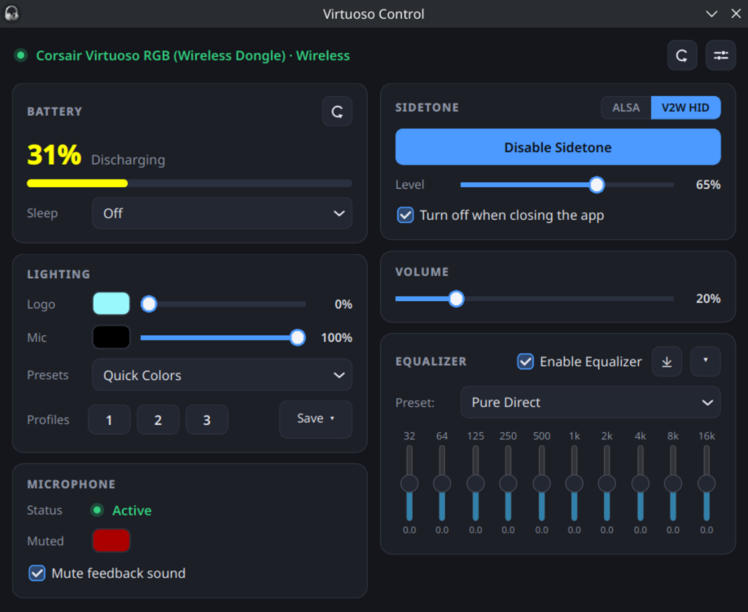

# Corsair Virtuoso SE/XT Control for Linux

A lightweight, persistent, and native control panel for the Corsair Virtuoso (SE/XT/Vanilla) headset lineup on Linux, built by reverse-engineering Corsair's proprietary Bragi and V2W HID protocols. It supports all Virtuoso models across both 2.4 GHz Slipstream wireless dongle and wired USB modes.

> **Note:** This entire application was "vibecoded" from scratch by Alejandro Socas with the assistance and auditing of Google's Gemini AI agent. 



## Key Features

*   **Compact 2-Column Dashboard:** Ergonomically designed two-column grid layout (740 × 578 px) keeping all essential controls in view without awkward vertical scrolling. The UI automatically follows your desktop's light or dark preference and switches live without requiring a restart.
*   **10-Band Real-Time PipeWire Equalizer:** Native 10-band graphic/parametric equalizer powered directly by PipeWire's DSP filter-chain. Includes the exact 10 frequency bands matching official Corsair iCUE (32 Hz, 64 Hz, 125 Hz, 250 Hz, 500 Hz, 1 kHz, 2 kHz, 4 kHz, 8 kHz, 16 kHz), smooth 150 ms debounced tuning, and one-click export of equalizer presets to **EasyEffects** (`~/.config/easyeffects/output/`).
*   **Official iCUE Sound Presets:** Ships with the official Corsair audio profiles extracted from iCUE:
    *   *Pure Direct* (Flat / Studio reference)
    *   *Movie Theater* (Immersive cinematic enhancement)
    *   *FPS Competition* (Heightened footsteps and high-frequency positional cues)
    *   *Clear Chat* (Vocal clarity and mid-range boost)
    *   *Bass Boost* (Deep low-end punch)
    *   *Custom* (Full manual 10-band user tuning)
*   **Hardware Smart Sleep & Standby (`SleepMode_StoreInDevice`):** Reverses and implements Corsair's native on-device sleep architecture. Programs the headset MCU's internal sleep registers (`0x0d`, `0x0e`, `0x37`) to work seamlessly with the headset's internal accelerometer / motion sensor. Intelligently coordinates with host PipeWire audio playback and desktop lock screens:
    *   Automatically mutes hardware ALSA sidetone and switches off LEDs upon entering sleep.
    *   Exits software control mode during standby, allowing the headset MCU to power down its RF transceiver without interference from polling pings.
    *   Passive, non-invasive wake-up detection when the headset is moved or audio resumes.
    *   Configurable timeout selector (1 min Debug, 5 min, 10 min Default, 15, 30, 60, 90 min, or Off).
*   **Official iCUE Voice Prompts:** Includes authentic voice notifications extracted from Corsair iCUE (*"Mic On"*, *"Mic Off"*, *"Connected"*, *"Disconnected"*, etc.) with a toggle option in Settings.
*   **Dual Sidetone Engine (ALSA & V2W HID):** Independent hardware sidetone feedback control with support for both the native kernel ALSA mixer and direct V2W HID protocol packets, plus an option to automatically disable sidetone when closing the app or entering standby.
*   **Accurate Battery Monitor & Hardware Indicators:** Reads actual battery state reliably, displaying exact percentages, charging status, and synchronizing with the headset's physical battery status LED (Green, Yellow, Red). Sends a desktop notification if battery drops below 15%.
*   **Smart Battery Polling:** Prevents the headset from emitting annoying "reconnection beeps" when battery is low (<15%) by automatically suspending wireless battery queries until connected via USB to charge.
*   **Dynamic Tray Icon:** The system tray icon acts as a live battery meter, dynamically filling up and changing colors (Green, Yellow, Red, or Blue when charging) based on the headset's battery level.
*   **Full RGB Lighting & Profiles:** Control the exact color and brightness of both the side Logo and the Microphone LED through native color pickers (wireless mode). Save up to 3 custom **RGB Profiles** and switch between them instantly from either the UI buttons or the system tray context menu.
*   **Physical Mic-Mute Button:** The headset's physical mute button maintains full hardware functionality. The app tracks state changes instantly, mutes the OS input, sets the mic LED to your custom "muted" color, and plays audio feedback.
*   **Dual-Mode Support (Wired / Dongle):** Automatically detects whether you are connected via the 2.4 GHz Slipstream wireless dongle or directly through USB-C, adapting available features accordingly.
*   **Bilingual Support (English & Spanish):** Seamlessly switch the entire application interface between English and Spanish directly from the Settings menu.
*   **Universal Autostart (FreeDesktop) & Start Minimized:** Option to start minimized to the system tray and register an autostart desktop entry for seamless background launch across GNOME, KDE, XFCE, and modern Wayland/X11 desktops.
*   **Persistent Connection:** Official iCUE-compatible heartbeat keeps the HID session alive, eliminating unexpected device disconnects.

## Prerequisites

The application requires `python3`, `pipewire` (for the equalizer), and a few standard libraries:

### USB permissions (required for all methods)

```bash
sudo cp 99-corsair-virtuoso-hid.rules /etc/udev/rules.d/
sudo udevadm control --reload-rules && sudo udevadm trigger
```

*(You may need to unplug and replug the wireless dongle for the udev rules to take effect).*

## Installation

### Option A: Automated system-wide installation (Recommended)

Run the installation script with superuser privileges (installs udev rules, copies icons, audio assets, and application files to `/opt/virtuoso-control`):

```bash
sudo ./install.sh
```

Once installed, you can launch **"Virtuoso Control"** directly from your application launcher or menu.

### Option B: Using uv

[uv](https://docs.astral.sh/uv/) handles Python dependencies automatically — no system packages needed:

```bash
git clone https://github.com/AlejandroSocas/VirtuosoControl.git
cd VirtuosoControl
uv run virtuoso-control
```

### Option C: Using system packages

Install the dependencies via your distribution package manager:

```bash
# Fedora / RHEL:
sudo dnf install python3-pyqt6 python3-hidapi pipewire

# Debian / Ubuntu:
sudo apt install python3-pyqt6 python3-hidapi pipewire

# Arch Linux:
sudo pacman -S python-pyqt6 python-hidapi pipewire
```

Then run directly from the project directory:

```bash
python3 virtuoso_gui.py
```

*(Ensure your user belongs to the `audio` or `input` group if required by your distribution for ALSA mixer synchronization).*

## Uninstallation

To completely remove the program, its shortcuts, and udev rules from your system:

```bash
sudo ./uninstall.sh
```

## Architecture & Reverse Engineering

This project was developed through deep reverse-engineering of Corsair iCUE binaries (`iCUE.dll`, `BragiProtocols.dll`, and Qt RCC manifests) using **REA (Reverse-Engineer-Anything)** and binary analysis, combined with USB/HID packet inspection via Wireshark:

*   **Bragi Protocol (`0x08` / `0x09` commands):** Reverse-engineered the proprietary property get/set mechanism (`OP_SLEEP_ENABLED = 0x0d`, `OP_SLEEP_TIMEOUT_NORMAL = 0x0e`, `OP_BATTERY_LEVEL = 0x07`, etc.) enabling direct hardware control of the headset MCU.
*   **On-Device Inactivity & Motion Sensor:** Implements the `SleepMode_StoreInDevice` specification. The Corsair Virtuoso hardware features an internal ultra-low-power accelerometer / IMU; the software coordinates host audio stream playback (via PipeWire) and screen lock state with the headset's onboard inactivity countdown.
*   **10-Band Parametric Filter Chain:** The exact frequency response curves, center frequencies (32 Hz to 16 kHz), and default Q/gain values of Corsair's equalizer were decompiled from iCUE's audio DSP configuration and mapped directly onto PipeWire's `filter-chain` module and EasyEffects presets.
*   **Clean Dual-Mode Sidetone:** Solved sidetone retention and noise leakage by interfacing with both the USB audio dongle's ALSA mixer hardware path and the proprietary V2W HID command layer.
