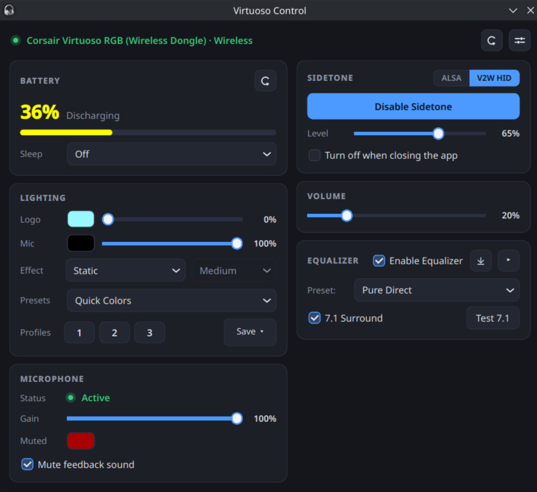

# Corsair Virtuoso SE/XT Control for Linux

A lightweight, persistent, and native control panel for the Corsair Virtuoso (SE/XT/Vanilla) headset lineup on Linux, built by reverse-engineering Corsair's proprietary Bragi and V2W HID protocols. It supports all Virtuoso models across both 2.4 GHz Slipstream wireless dongle and wired USB modes.

> **Note:** This entire application was "vibecoded" from scratch by Alejandro Socas with the assistance and auditing of Google's Gemini AI agent. 



## Key Features

*   **Compact 2-Column Dashboard:** Ergonomically designed two-column grid layout (740 px wide, auto-fitted height) keeping all essential controls in view without vertical scrolling. The UI automatically follows your desktop's light or dark preference and switches live without requiring a restart.
*   **10-Band Real-Time PipeWire Equalizer:** Native 10-band graphic/parametric equalizer powered directly by PipeWire's DSP filter-chain. Includes the exact 10 frequency bands matching official Corsair iCUE (32 Hz, 64 Hz, 125 Hz, 250 Hz, 500 Hz, 1 kHz, 2 kHz, 4 kHz, 8 kHz, 16 kHz), smooth 150 ms debounced tuning, and one-click export of equalizer presets to **EasyEffects** (`~/.config/easyeffects/output/`).
*   **Virtual 7.1 Surround (PipeWire Binaural HRIR) & Zero-Hiss Volume:** Native 8-channel (`FL, FR, FC, LFE, RL, RR, SL, SR`) binaural HRIR convolver downmix chained with the 10-band EQ. Both 2.0 EQ and 7.1 Surround keep the headset hardware sink (`HW_VOLUME_CTRL`) as the system default sink while pinning the virtual DSP node at 100% unity gain (`node.pause-on-idle = true`), eliminating background static hiss and keeping the desktop slider and headset volume wheel responsive at all times. Includes a built-in **Test 7.1** 8-channel discrete speaker sweep (`pw-play` / `paplay`).
*   **Official iCUE Sound Presets:** Ships with the official Corsair audio profiles extracted from iCUE:
    *   *Pure Direct* (Flat / Studio reference)
    *   *Movie Theater* (Immersive cinematic enhancement)
    *   *FPS Competition* (Heightened footsteps and high-frequency positional cues)
    *   *Clear Chat* (Vocal clarity and mid-range boost)
    *   *Bass Boost* (Deep low-end punch)
    *   *Custom* (Full manual 10-band user tuning)
*   **Native Hardware Sleep & Wake Recovery (`SleepMode_StoreInDevice`):** Programs the headset MCU's internal sleep registers (`OP_SLEEP_ENABLED = 0x0d`, `OP_SLEEP_TIMEOUT_NORMAL = 0x0e`) to work natively with the headset's built-in accelerometer / motion sensor. Includes configurable timeout presets (1 min Debug, 5 min, 10 min Default, 15, 30, 60, 90 min, or Off) and automatic Software Mode / LED / sidetone recovery when the headset wakes up (`OP_OPERATING_MODE = 0x03`, 25 s keep-alive).
*   **Full RGB Lighting, Logo Brightness & Dynamic Effects:** Control the exact color and hardware brightness (`OP_BRIGHTNESS = 0x02`) of both the side Logo and the Microphone LED (wireless mode), choose between **Static**, **Rainbow**, **Color Pulse**, **Color Shift**, and **Battery Reactive** effects with speed control (*Slow / Medium / Fast*) and *Quick Colors*, and save/load up to **3 custom RGB Profiles** from the UI or tray menu.
*   **Microphone Gain & Physical Mute Button:** Dedicated PipeWire microphone input gain slider (0–100%) synced with the OS, plus full tracking of the headset's physical mute button (mutes PipeWire input, switches mic LED to your custom mute color, and plays audio feedback).
*   **Official iCUE Voice Prompts & Reminders:** Authentic voice cues extracted from Corsair iCUE (*"Mic On"*, *"Mic Off"*, *"Surround On"*, *"Surround Off"*, *"Battery Low"*, etc.) with optional periodic voice reminders for low battery and muted microphone in Settings.
*   **Hardware Power Saving & Live Device Info:** Toggle hardware power saving (`OP_POWER_SAVING = 0x0b`) and inspect real-time device telemetry inside Settings (headset & dongle firmware versions, polling rate in Hz, RF encryption status, battery voltage in mV, and hardware sleep configuration).
*   **Sidetone Control:** Independent sidetone level and mute toggle via the native ALSA mixer (the V2W UI toggle safely routes to ALSA to avoid firmware lockups from incompatible Void opcodes), with an option to turn off sidetone when closing the app.
*   **Accurate Battery Monitor & Configurable Tray Icons:** Reads battery percentage, voltage, and charging state reliably, synchronizes the physical battery LED (Green, Yellow, Orange, Red / blinking), disables polling under 15% when unplugged to avoid firmware beeps, and lets you show the Virtuoso icon, a dynamic Battery meter icon, or both in the system tray.
*   **Bilingual Support (English & Spanish) & Autostart:** Switch live UI strings between English and Spanish from Settings, and configure universal FreeDesktop autostart and "start minimized to tray".

## Prerequisites

The application requires `python3`, `pipewire` (for EQ and 7.1 Surround), `pw-play` / `paplay`, and `hidapi` + `PyQt6`.

### USB permissions (required for all methods)

```bash
sudo cp 99-corsair-virtuoso-hid.rules /etc/udev/rules.d/
sudo udevadm control --reload-rules && sudo udevadm trigger
```

*(You may need to unplug and replug the wireless dongle for the udev rules to take effect).*

## Installation

### Option A: Automated system-wide installation (Recommended)

Run the installation script with superuser privileges (installs udev rules, copies icons, audio assets, and all modular Python files to `/opt/virtuoso-control`):

```bash
sudo ./install.sh
```

Once installed, you can launch **"Virtuoso Control"** directly from your application launcher or menu.

### Option B: Using uv

[uv](https://docs.astral.sh/uv/) handles Python dependencies automatically — no system packages needed:

```bash
git clone https://github.com/AlejandroSocas/VirtuosoControl.git
cd VirtuosoControl
uv run virtuoso-control
```

### Option C: Using system packages

Install the dependencies via your distribution package manager:

```bash
# Fedora / RHEL:
sudo dnf install python3-pyqt6 python3-hidapi pipewire

# Debian / Ubuntu:
sudo apt install python3-pyqt6 python3-hidapi pipewire

# Arch Linux:
sudo pacman -S python-pyqt6 python-hidapi pipewire
```

Then run directly from the project directory:

```bash
python3 virtuoso_gui.py
```

*(Ensure your user belongs to the `audio` or `input` group if required by your distribution for ALSA mixer synchronization).*

## CLI Usage

The backend controller can also be used standalone from the terminal:

```bash
python3 virtuoso_control.py battery                # Read battery % and charging state
python3 virtuoso_control.py device-info            # Dump FW, polling rate, RF encryption & voltage
python3 virtuoso_control.py brightness 80          # Set hardware Logo LED brightness (0-100)
python3 virtuoso_control.py rgb 255 180 0 100      # Set Logo color and brightness
python3 virtuoso_control.py mic-volume 85          # Set PipeWire microphone gain (0-100)
python3 virtuoso_control.py eq enable "FPS Competition"
python3 virtuoso_control.py surround on            # Enable 8ch PipeWire Virtual 7.1 Surround
python3 virtuoso_control.py surround test          # Play 8-channel discrete speaker test sweep
python3 virtuoso_control.py sleep 10               # Set hardware auto-sleep timeout in minutes
python3 virtuoso_control.py power-save on          # Toggle hardware power saving mode
```

## Project Structure

```text
├── virtuoso_protocol.py   # USB IDs, EQ bands/presets, and Bragi/V2W protocol constants
├── virtuoso_audio.py      # PipeWire 10-band EQ & binaural 7.1 HRIR DSP state machine
├── virtuoso_control.py    # Persistent HID/V2W controller, battery/ALSA control, and CLI
├── virtuoso_i18n.py       # English / Spanish translation catalog and _tr() helper
├── virtuoso_theme.py      # Light/dark palettes, QSS stylesheet, and vector icon painters
├── virtuoso_widgets.py    # Custom painted widgets (BatteryGauge, ColorSwatch, etc.) & SettingsDialog
├── virtuoso_gui.py        # Main PyQt6 dashboard, tray integration, and timers
├── assets/ & sounds/      # UI SVG assets and official iCUE voice prompts
└── install.sh / uninstall.sh
```

## Uninstallation

To completely remove the program, its shortcuts, and udev rules from your system:

```bash
sudo ./uninstall.sh
```

## Architecture & Reverse Engineering

This project was developed through reverse-engineering of Corsair iCUE binaries (`iCUE.dll`, `BragiProtocols.dll`, and Qt RCC manifests) combined with USB/HID packet inspection via Wireshark:

*   **Bragi Protocol (`EP_RECEIVER = 0x08` / `EP_HEADSET = 0x09`):** Verified property commands (`CMD_SET_PROP = 0x01`, `CMD_GET_PROP = 0x02`, `CMD_PING = 0x11`) and hardware registers (`OP_BRIGHTNESS = 0x02`, `OP_OPERATING_MODE = 0x03`, `OP_POWER_SAVING = 0x0b`, `OP_SLEEP_ENABLED = 0x0d`, `OP_SLEEP_TIMEOUT_NORMAL = 0x0e`, `OP_BATTERY = 0x0f`, `OP_FIRMWARE_VERSION = 0x13`, `OP_BATTERY_VOLTAGE = 0x53`).
*   **On-Device Inactivity & Motion Sensor:** Implements `SleepMode_StoreInDevice` directly in the headset MCU firmware so the onboard accelerometer controls sleep/wake natively, while the GUI detects Software/Hardware mode transitions (`OP_OPERATING_MODE`) and re-applies lighting/settings cleanly on wake.
*   **10-Band EQ + Binaural 7.1 Filter Chain:** Maps iCUE's exact frequency bands (32 Hz low-shelf, 64 Hz–8 kHz peaking Q=1.414, 16 kHz high-shelf) and a 14-channel HeSuVi-compatible HRIR convolver onto PipeWire's `libpipewire-module-filter-chain` with deterministic node lifecycle management and zero-hiss unity-gain DSP routing.
*   **Safe Dual-Mode Sidetone:** Drives the USB audio dongle's ALSA mixer path cleanly while safeguarding the Virtuoso MCU against incompatible Void V2W sidetone opcodes.
